<p align="center">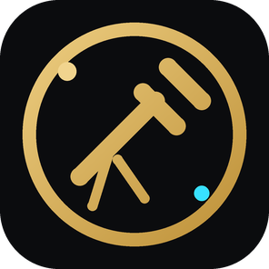</p>

<h1 align="center">Lion Telescope Studio</h1>
<p align="center"><b>The sky as the world's open telescopes see it</b><br>
Every kind of light from gamma rays to radio on one sky you can drag through, a click report on any spot (what is there, its
planets, and which telescopes have looked at it), live gravitational waves, gamma-ray flashes, supernovae and the Sun, and
where Webb and Chandra are pointing right now. One small Python server, any browser.</p>

<p align="center"><em>Created by <a href="https://github.com/sunnychase">Sunny Chase</a> in collaboration with Claude (Anthropic).</em></p>

<p align="center">
  <a href="https://github.com/sunnychase/lion-telescope-studio/actions/workflows/ci.yml"></a>
  <a href="LICENSE"></a>
  <a href="#requirements"></a>
  <a href="https://aladin.cds.unistra.fr/AladinLite/"></a>
  <a href="#requirements"></a>
  <a href="#data-sources-and-licences"></a>
  <a href="https://github.com/sunnychase/lion-telescope-studio/commits/main"></a>
  <a href="https://donate.stripe.com/fZuaER2Cbecw7cQ6PlfEk00"></a>
</p>

<p align="center">
  <a href="#quick-start">Quick start</a> ·
  <a href="#what-it-does">What it does</a> ·
  <a href="#how-it-works">How it works</a> ·
  <a href="#configuration">Configuration</a> ·
  <a href="#data-sources-and-licences">Data &amp; licences</a> ·
  <a href="#known-limits">Known limits</a> ·
  <a href="#faq">FAQ</a> ·
  <a href="#contributing">Contributing</a>
</p>

<p align="center">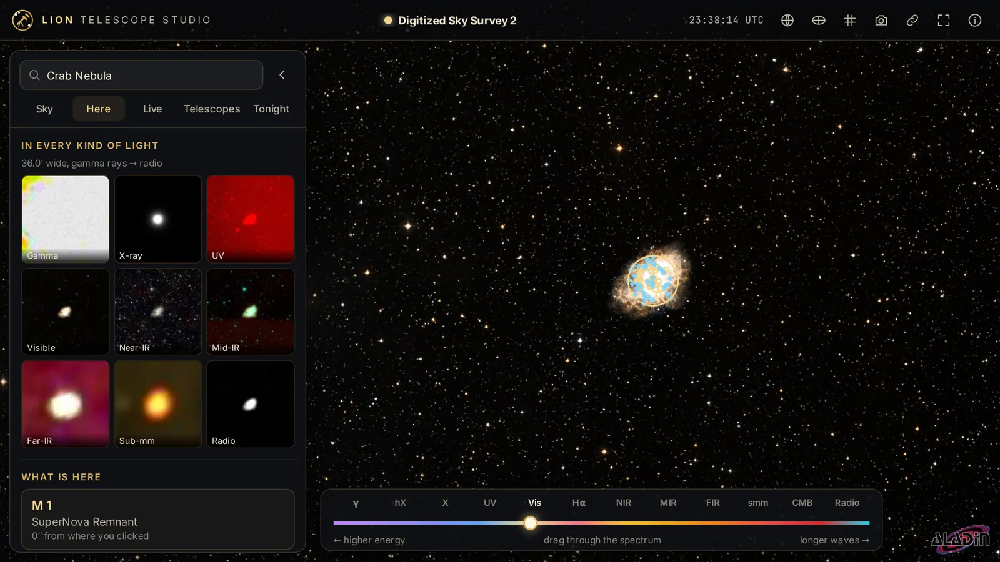<br>
<sub>The Crab Nebula, with the point report's strip of the same spot in nine kinds of light. Sky: DSS2 (STScI/NASA, CDS).</sub></p>

Lion Telescope Studio puts the public archives of the world's observatories behind one sky. The sky itself is
[Aladin Lite](https://aladin.cds.unistra.fr/AladinLite/) from CDS Strasbourg, showing all-sky surveys from Fermi to Planck;
a small Python server asks SIMBAD, Gaia, the NASA Exoplanet Archive, MAST, ESO, HEASARC, GraceDB, ALeRCE, SDO and JPL Horizons
on your behalf, caches every answer, and turns them into plain-language reports. Nothing needs an account or a key.

## Quick start

```bash
git clone https://github.com/sunnychase/lion-telescope-studio.git && cd lion-telescope-studio
python3 scripts/precompress.py      # optional: gzip copies of the page's files, so it loads faster
python3 server.py                   # then open http://127.0.0.1:8650
```

That is the whole install: the server uses only the Python standard library, and Aladin Lite, astronomy-engine, CesiumJS,
satellite.js and the fonts are in the repository. Sky tiles stream from the survey servers as you look around.

To run it as a service that starts with your computer, see [systemd/lion-telescope-studio.service](systemd/lion-telescope-studio.service).

## What it does

### 1. The sky in every kind of light

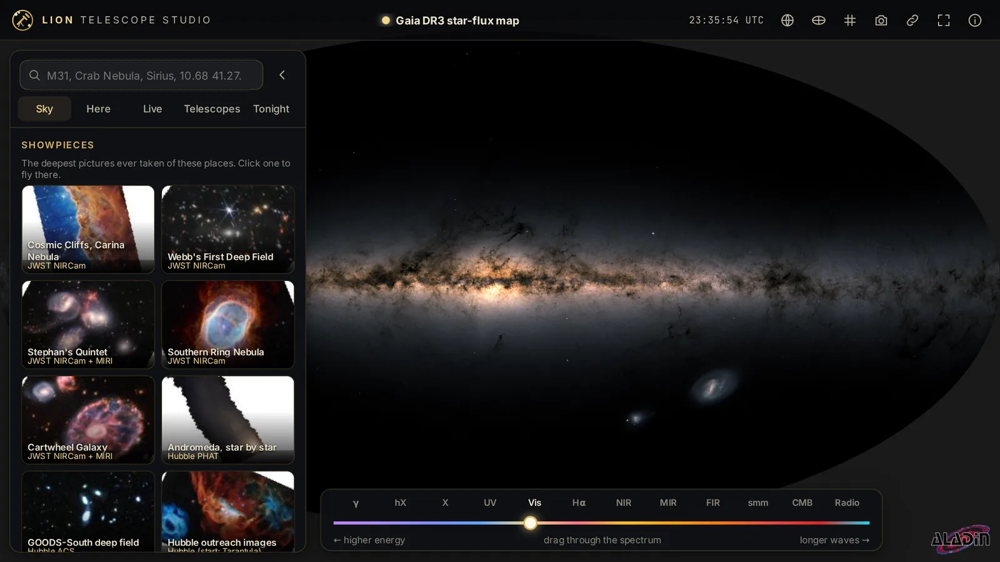

- **The ladder**: drag one slider through twelve all-sky surveys, from gamma rays (Fermi) through X-rays, ultraviolet, visible,
  infrared and the cosmic microwave background (Planck) to radio. Between two steps the surveys blend. `[` and `]` step through.
- **Deeper when you zoom in**: a few steps swap to a sharper survey below a set field of view (visible light → DSS2,
  X-rays → eROSITA, radio → NVSS), so zooming in does not just magnify pixels.
- **The library**: about forty more surveys grouped by band (2MASS, unWISE, GALEX, AKARI, Planck dust and CO, H-alpha,
  HI4PI, …), with who made each one and how much of the sky it covers.
- **Showpieces**: the deepest pictures ever taken of small patches (Webb's Cosmic Cliffs and First Deep Field, Stephan's
  Quintet, the Hubble PHAT mosaic of Andromeda, Euclid's Einstein ring, Rubin's first look, MeerKAT's Galactic centre).
  Opening one flies there.
- **Search** any name SIMBAD knows ("M31", "Crab Nebula", "Sirius") or coordinates in degrees or sexagesimal. Every view is a
  link: the address bar keeps the position, survey and zoom.

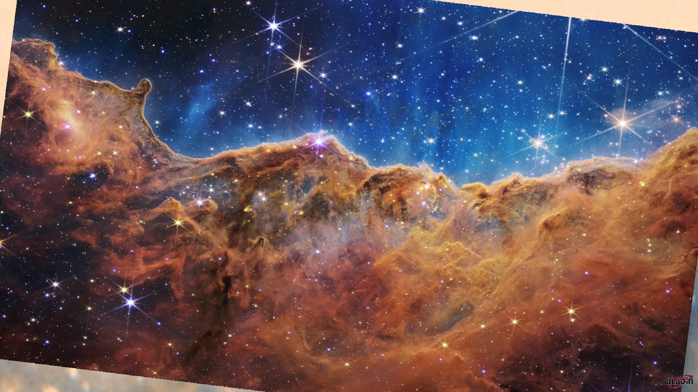 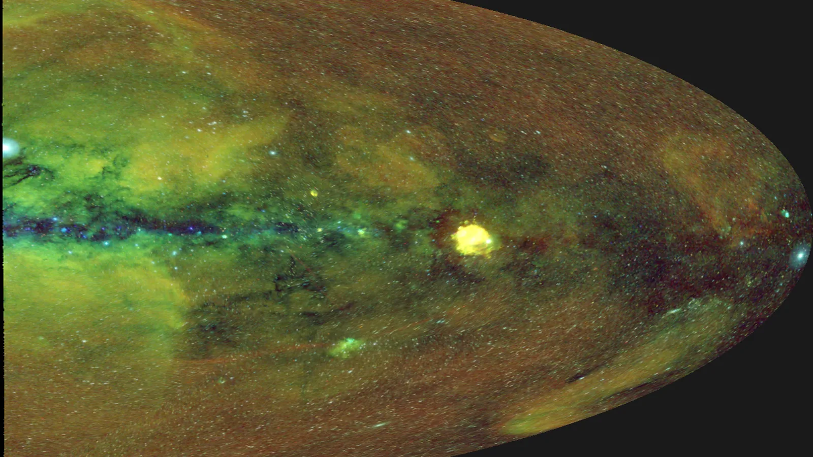
<sub>Left: JWST NIRCam, Cosmic Cliffs (NASA, ESA, CSA, STScI). Right: eROSITA DR1 (MPE / eROSITA-DE).</sub>

### 2. Click anywhere: the point report

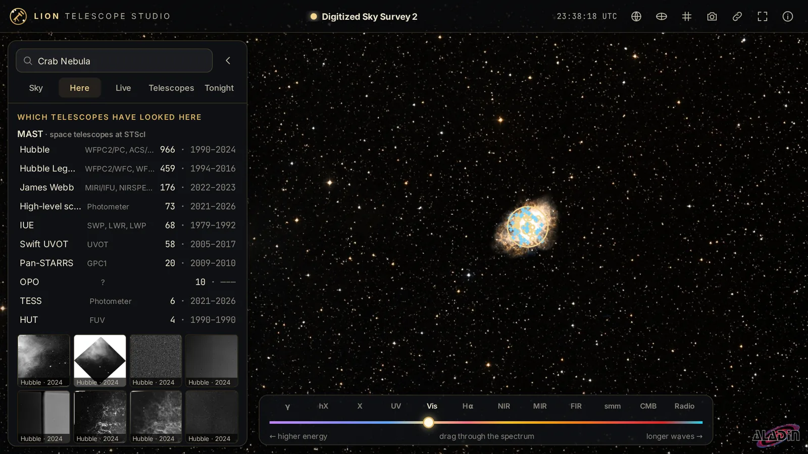 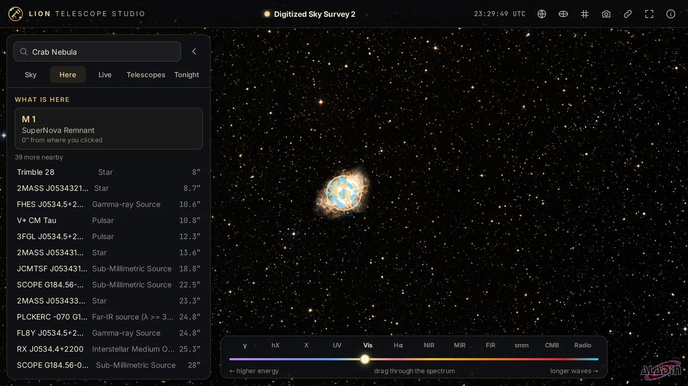

- **What is here**: the nearest named object and everything SIMBAD lists around it, with types and distances.
- **In every kind of light**: the same spot cut out of nine surveys (CDS hips2fits).
- **Stars**: Gaia DR3 stars with distance and colour. **Planets**: confirmed exoplanets from the NASA Exoplanet Archive.
- **Which telescopes have looked here**: observations from MAST (Hubble, Webb, TESS, GALEX, Pan-STARRS…), the ESO archive (VLT,
  VISTA, VST, ALMA…) and NASA HEASARC (Chandra, XMM-Newton, Swift, NuSTAR, NICER, IXPE, XRISM…), with years and preview images.

### 3. Live: what the sky is doing now

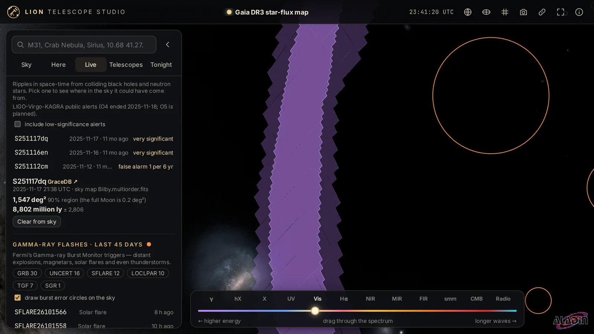 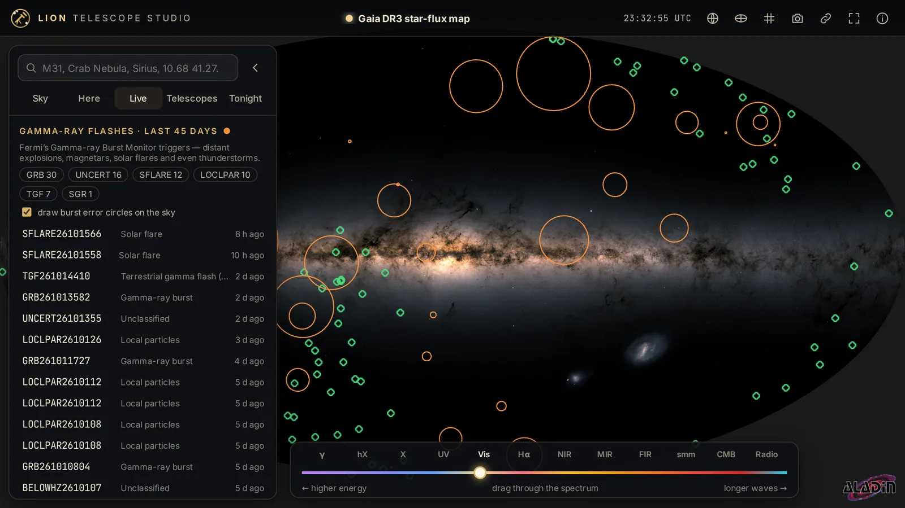

- **Gravitational waves**: LIGO-Virgo-KAGRA public alerts from GraceDB; open one to draw its 50 % and 90 % sky region.
- **Gamma-ray flashes**: Fermi GBM triggers of the last 45 days (gamma-ray bursts, solar flares, magnetars, terrestrial gamma-ray
  flashes) as circles on the sky.
- **Supernova candidates**: recent ZTF alerts classified as supernovae by the ALeRCE broker.
- **The Sun**: NASA SDO's latest images in six channels, plus NOAA SWPC's GOES X-ray flux, flares and the Kp index.

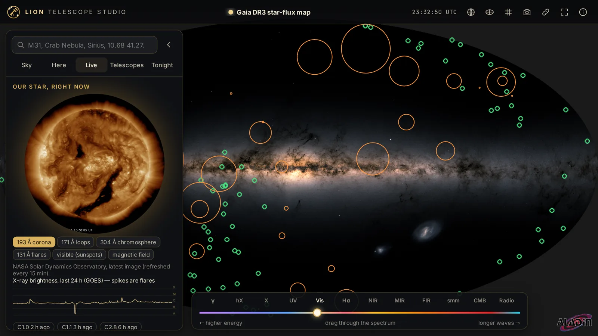

### 4. Telescopes: where they are pointing

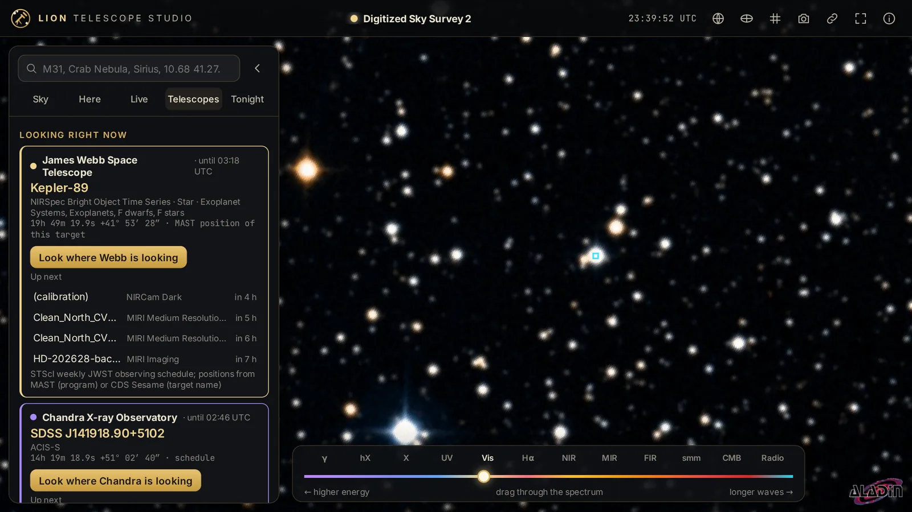 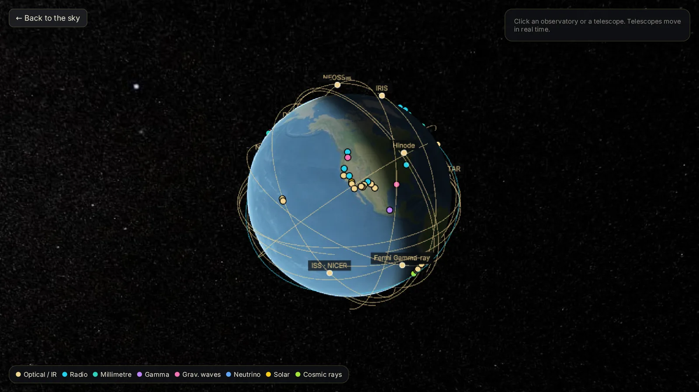

- **Looking right now**: the current and next targets of JWST (STScI's weekly schedule) and Chandra (the CXC short-term
  schedule), with a button that flies the sky there; Hubble's and TESS's most recent pointings from MAST.
- **Earth view**: a 3D globe (CesiumJS) with about fifty observatories by the kind of light they collect, and the telescopes in
  orbit computed live from CelesTrak's orbital elements (Hubble, the ISS, Fermi, Swift, NuSTAR, TESS…). Webb, Euclid, Gaia and SOHO
  are placed from JPL Horizons.

### 5. Tonight: your own sky

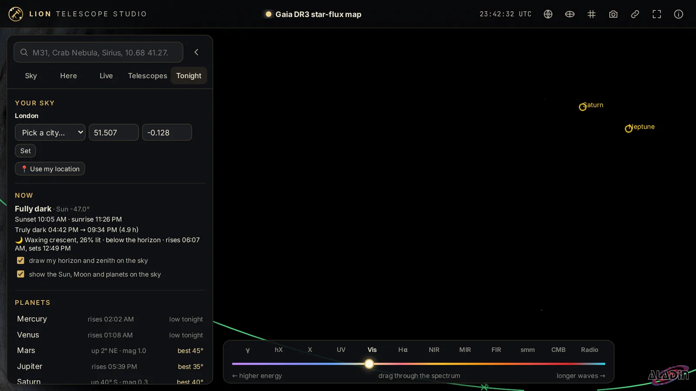

Pick a city or use your location: sunset and full darkness, the Moon's phase and rise, when each planet is best, and your
horizon and zenith drawn on the sky (astronomy-engine, computed in the browser).

**On a phone** the panel becomes a bottom sheet and the spectrum ladder moves to the top:

<p align="center">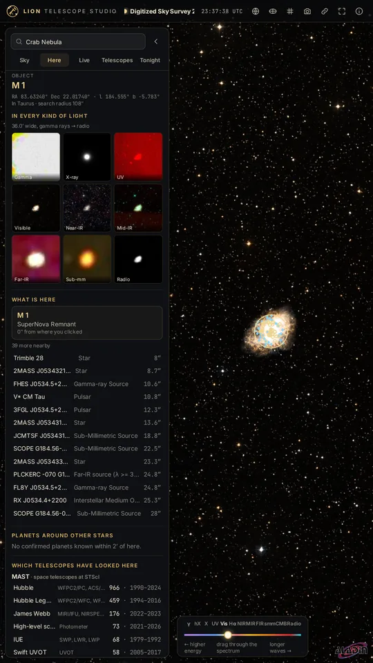 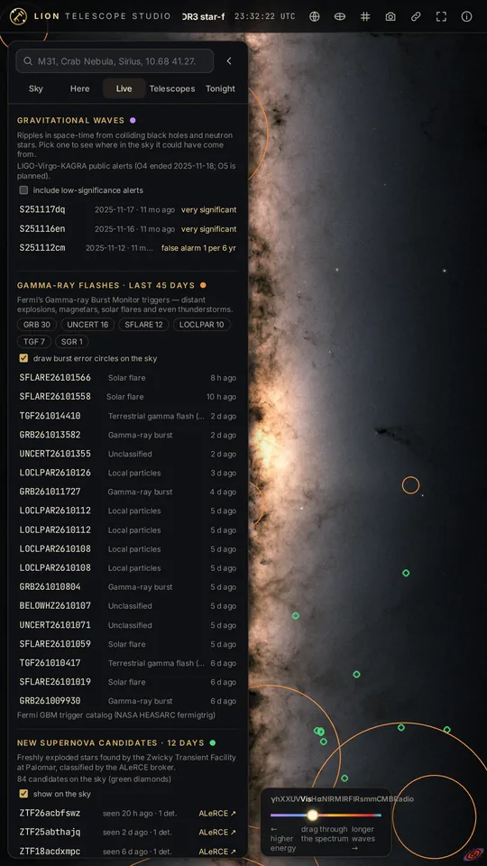</p>

## How it works

```
browser ── Aladin Lite ─────────────── HiPS sky tiles ← CDS, ESA, survey servers (straight from the browser)
   │  ── astronomy-engine (Tonight), satellite.js (orbits), CesiumJS (Earth view)
   │
   └─ /api/* ── server.py (standard library) ── disk cache ── SIMBAD/Sesame, Gaia, Exoplanet Archive, MAST, ESO, HEASARC,
                                                             GraceDB, ALeRCE, SDO, SWPC, CelesTrak, JPL Horizons, STScI, CXC
```

- **One file, no packages.** `server.py` serves `static/` and a fixed set of `/api/` endpoints; `votable.py` reads the VOTable
  answers (TABLEDATA and BINARY/BINARY2) that astronomy archives return.
- **Polite caching.** Every upstream answer is cached on disk: names 30 days, point reports 1–7 days per spot, schedules hourly
  to six-hourly, alerts minutes. A stale entry is served while one background refresh runs. CelesTrak is asked at most once
  per group every two hours, as it requests.
- **Not an open proxy.** Every upstream URL is a template in the code; numbers from the browser are clamped and names
  pattern-checked. New lookups are rate-limited (point reports one new spot per 1.5 s, name lookups two per second).
- `GET /api/status` reports the cache and each upstream's last answer.

## Requirements

- **Python 3.10 or newer** (standard library only). Linux, macOS or Windows.
- A **modern browser** with WebGL 2 (Chrome, Edge, Firefox, Safari 16+). Aladin Lite renders with WebGL.
- **Internet access** from both the server (archives) and the browser (sky tiles).
- About **30 MB** for the repository and up to a few hundred MB of cache.

## Configuration

All settings are environment variables with safe defaults; copy [telescope.env.example](telescope.env.example) to
`telescope.env` to change them (the systemd unit reads it).

| Variable | Default | What it does |
|---|---|---|
| `SKY_HOST` | `127.0.0.1` | Address to listen on. `0.0.0.0` serves your local network; there is no login, so only on a network you trust. |
| `SKY_PORT` | `8650` | Port. |
| `SKY_CACHE_DIR` | `cache/` next to `server.py` | Where upstream answers are cached. |
| `SKY_SHARED_CELESTRAK_DIR` | unset | Optional: the CelesTrak cache of a [Lion Satellite Studio](https://github.com/sunnychase/lion-satellite-studio) on the same machine, read-only, so orbital elements are downloaded once. |

## Data sources and licences

The code of this repository is **GPL-3.0-or-later** ([LICENSE](LICENSE)), because the page bundles Aladin Lite, which is
GPL-3.0. The bundled libraries keep their own licences (astronomy-engine and satellite.js MIT, CesiumJS Apache-2.0, fonts OFL),
and the data keeps its providers' terms. [NOTICE.md](NOTICE.md) lists every component, every source and the credit each asks
for.

Most sources are open for any use with credit. Three are not, and the app labels them:

- **Mellinger all-sky optical survey**: © Axel Mellinger, all rights reserved. It is shown live from CDS's server and is not
  redistributed here; do not reuse pictures of it without his permission.
- **Gaia DR3 star-flux map** (CC BY-NC) and **Euclid Q1** (CC BY-NC 3.0 IGO): non-commercial use only.
- **Planck**: ESA; credit ESA and the Planck Collaboration.

The project is not affiliated with or endorsed by any observatory or agency named here.

## Known limits

- **MAST is slow** at crowded spots (its cone search can take 40 s or time out); answers are cached for a day, so a second
  click is instant.
- **Gamma-ray bursts come from Fermi GBM only**: the Swift trigger table on HEASARC is no longer updated.
- **Fink** (the second ZTF broker) is not used: its API was down when this was built. Supernovae come from ALeRCE.
- **Gravitational waves**: the LIGO-Virgo-KAGRA O4 run has ended, so the newest alerts are from 2025 until the next run.
- **The Sun**: SDO's "latest" images stopped updating on 2026-09-21 on NASA's side; the panel shows the newest image there is.
  The X-ray flux and flares (NOAA SWPC) are live.
- **Tonight** shows times in your browser's time zone, not the chosen city's.
- **AKARI** in the library can make Aladin Lite fail in software WebGL (for example headless browsers using SwiftShader);
  real GPUs are fine.

## FAQ

**Does it need an API key or an account?** No. Every source is public and keyless.

**Does it work offline?** The page and the Earth view do; the sky tiles and reports need the internet. Cached answers keep
working when an archive is down.

**Can I put it on the internet?** It has no login. Keep the default `127.0.0.1`, or put it behind an authenticating reverse
proxy or tunnel. See [SECURITY.md](SECURITY.md).

**Why is it GPL when the sibling projects are MIT?** Aladin Lite, which draws the sky, is GPL-3.0, and this repository ships a
copy of it.

**Where do the sky pictures come from?** From the survey servers themselves, straight to your browser through Aladin Lite;
this server never touches the tiles.

## Contributing

Bug reports, fixes and new sources are welcome; see [CONTRIBUTING.md](CONTRIBUTING.md). Security problems: [SECURITY.md](SECURITY.md).
Changes are listed in [CHANGELOG.md](CHANGELOG.md).

Sibling projects: [Lion AI Studios](https://github.com/sunnychase/lion-ai-studios) (local video, image and music generation)
and [Lion Satellite Studio](https://github.com/sunnychase/lion-satellite-studio) (open satellite data on a 3D globe).

## Credits

Created by [Sunny Chase](https://github.com/sunnychase) in collaboration with Claude (Anthropic). Sky viewer: Aladin Lite
© CDS, Université de Strasbourg/CNRS. This research has made use of the SIMBAD database and the "Aladin sky atlas" developed
at CDS, Strasbourg Observatory, France; of the NASA Exoplanet Archive; of data from the ESA mission Gaia; of MAST at STScI; of
the ESO Science Archive Facility; and of HEASARC at NASA/GSFC. Full list: [NOTICE.md](NOTICE.md).
